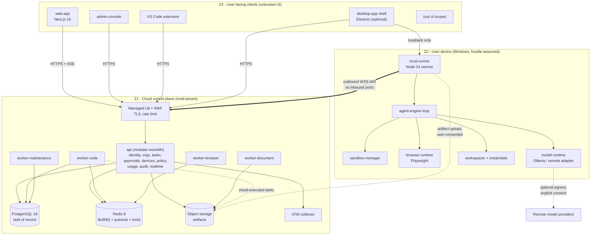
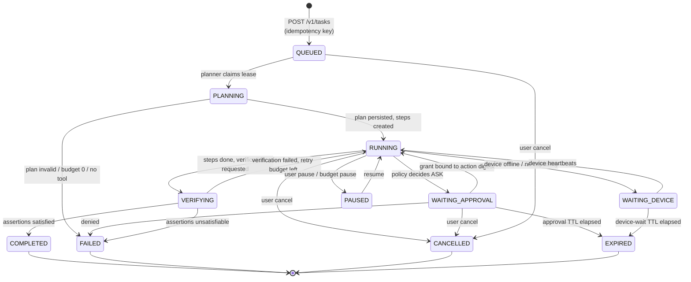
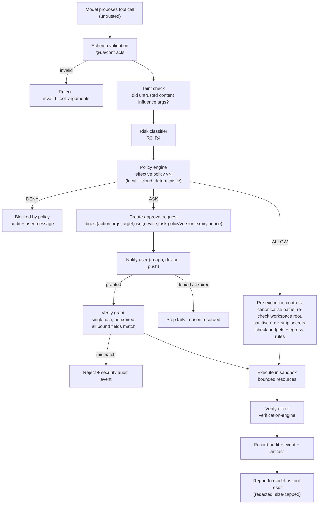
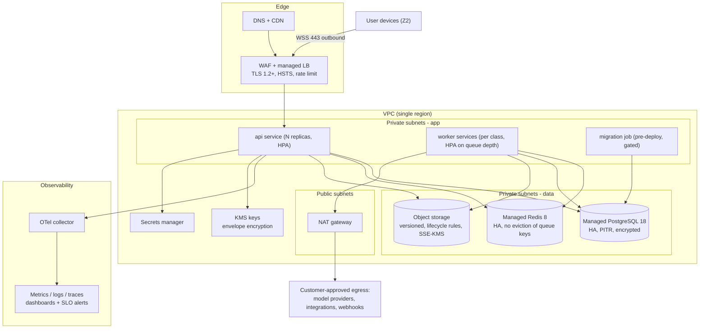
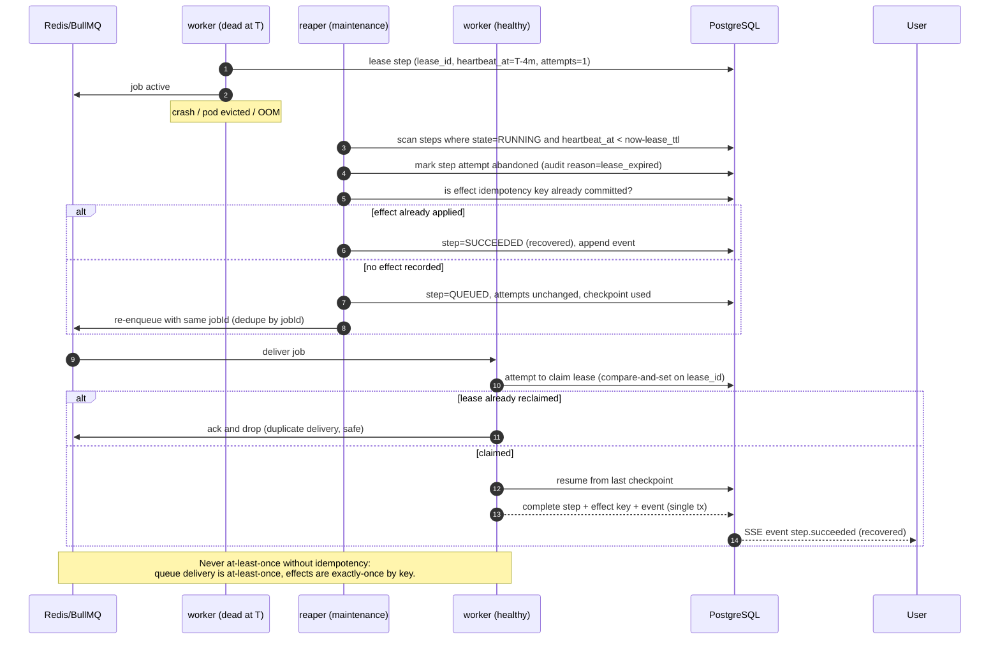

# 03 — System Architecture

| | |
|---|---|
| Status | Planning only. `[PROPOSED]` throughout. Nothing here is implemented. |
| Owner | Architecture |
| Depends on | `01` (facts), `05` (versions), `04` (decision records) |
| Diagrams | 6 Mermaid diagrams (§7). These are documentation, not code. |

## 1. Architectural principles

| # | Principle | Consequence if violated |
|---|---|---|
| A-1 | **Local-first execution.** The device owns the work, the data and the models; the cloud owns identity, coordination, policy, audit and metering. | Privacy promise breaks; GPU costs explode; the 100k-user target becomes unaffordable. |
| A-2 | **Deterministic authorisation.** Models propose; the policy engine disposes. | Prompt injection becomes remote code execution on user machines. |
| A-3 | **One tenant key everywhere.** Every tenant-owned row and every cache key carries `organization_id`. | Cross-tenant leak. |
| A-4 | **Durable intent, idempotent effect.** Write intent to Postgres, then queue; every external effect is guarded by an idempotency key. | Lost or duplicated work, double-posted comments, double-paid invoices. |
| A-5 | **Every boundary is an interface.** Coding engine, model provider, sandbox, browser, storage, queue, notifier. | Version churn (OpenCode V2, TS 7, Prisma 8) becomes a rewrite. |
| A-6 | **Outbound-only device channel.** No inbound ports, no inbound firewall rules. | Enterprise customers cannot deploy it; NAT breaks it. |
| A-7 | **Earn each service.** A module becomes a separate deployable only when a documented trigger is hit. | Nine half-built services, no product. |
| A-8 | **Bounded everything.** Steps, time, tokens, cost, retries, queue depth, artifact size. | Runaway loops, unbounded cost, stuck tasks. |
| A-9 | **Observable by default.** Correlation IDs and OTel spans from the first endpoint. | Un-diagnosable incidents at exactly the wrong time. |
| A-10 | **Windows is a first-class target** (process trees, job objects, reparse points, services). | The primary platform is the least tested platform. |

## 2. Three trust zones

| Zone | Contains | Trust level | Network entry |
|---|---|---|---|
| **Z1 — Cloud control plane** (untrusted multi-tenant, internet-facing) | API, workers, Postgres, Redis, object storage, admin console | Fully untrusted input; tenant-isolated data | Public HTTPS/WSS inbound |
| **Z2 — User device** (semi-trusted, user-controlled) | Local runner, sandbox, browser runtime, model runtime, workspaces, credentials | Hostile-by-assumption: the cloud must not trust its reports; the device must not execute unverified cloud commands without policy | **Outbound only** (WSS 443) |
| **Z3 — User-facing clients** (browser, desktop UI, IDE) | Web app, admin console, desktop shell, VS Code extension | Untrusted UI; holds a session token, never a device private key or a provider secret | Public HTTPS inbound to cloud; loopback to the local runner |

Key rule: `[PROPOSED]` **Z3 never talks to Z1 with a device credential and never
talks to Z2 with a cloud session token.** The desktop shell may talk to the
local runner over loopback with a short-lived local token, and to the cloud with
the user's session.

## 3. Deployment units (and why there are only six)

`[PROPOSED]` The brief proposed nine backend apps. We ship **one API deployable
plus four worker classes plus the local runner**. Reasoning in §4.

| Deployable | Contents | Scaling unit | Isolation rationale |
|---|---|---|---|
| `api` | NestJS modular monolith: identity, orgs, tasks, approvals, devices, integrations, usage, notifications, audit, realtime (SSE/WSS) | Stateless replica, HPA on RPS + p95 latency | Single blast radius, shared DB transactions, one auth path |
| `worker-code` | Agent loop execution for code/workspace tools; embeds OpenCode SDK or calls a runner | Replica per queue concurrency | Untrusted code execution, high CPU, different image |
| `worker-browser` | Playwright browser contexts for cloud-side browsing; also serves device-browser orchestration | Replica, memory-bound | Needs libs + browsers, memory-heavy, network egress policy |
| `worker-document` | PDF/Office/CSV parsing, OCR later, artifact generation | Replica, IO/CPU-bound | Native parsers are a distinct supply-chain risk |
| `worker-maintenance` | Reaper, reconciliation, retention, usage roll-ups, notification fan-out, scheduled jobs | Single leader with lock | Idempotent background duties |
| `local-runner` | Agent loop for device-located tasks, sandbox, model runtime, browser runtime, MCP client, updater | 1 per device | Runs on the user's machine, not ours |

Everything else (`agent-orchestrator`, `task-service`, `approval-service`,
`device-service`, `integration-service`, `billing-service`,
`notification-service`, `identity-service`, `api-gateway`) is a **module inside
`api`** at first. `api-gateway` is not a service either: TLS termination,
rate limiting, authn edge and routing are the managed load balancer's job plus
a NestJS guard/pipe chain.

## 4. Service-splitting triggers (earn each service)

`[PROPOSED]` A module is extracted into its own deployable only when a trigger is
met **and measured**. Until then it is a NestJS module with its own folder,
its own public interface and no cross-module DB access (module boundaries are
enforced by lint rules, not by network hops).

| Candidate | Trigger to extract | Why not now |
|---|---|---|
| Realtime/SSE gateway | > 5,000 concurrent open streams per pod, or stream handling starves request threads | Last scale step, not a first design step |
| `agent-orchestrator` | Plan/step execution CPU saturates the API pods, or needs different autoscaling (bursty, GPU-adjacent) | Its state lives next to the tasks table |
| `notification-service` | > 5 providers, retry storms, or email reputation management becomes a specialist job | One BullMQ queue + one outbox consumer is enough |
| `integration-service` | Third-party rate-limit back-pressure starts affecting API latency | Integration calls are already async via workers |
| `billing-service` | Payment reconciliation, tax and dunning genuinely need their own correctness boundary | No paying customers yet |
| `identity-service` | SSO/SCIM/compliance demands a separate credential blast radius, or > 3 auth protocols | A module with a strict interface is safer now than a split with two auth paths |

Review point: at the end of Phase 9 (`17-implementation-roadmap.md`), re-evaluate
all six with measured data.

## 5. Directory-by-directory specification

Target monorepo `universal-agent/`. For each area: responsibility, public
interface, dependencies, data ownership, security boundary, deployment, testing,
scaling. Format: one block per area, so nothing is lost in a wide table.

### 5.1 `frontend/web-app`

- **Responsibility:** end-user product UI — auth, dashboard, new task, task workspace, history, approvals, artifacts, devices, models, integrations, usage, settings.
- **Public interface:** consumes `@ua/client` (generated from `@ua/contracts`) and the SSE event stream. Owns no business logic that the API cannot reproduce.
- **Depends on:** `@ua/client`, `@ua/contracts`, `@ua/ui` (shared components), `@ua/telemetry`.
- **Data ownership:** none. Only browser-local UI state; no authoritative data.
- **Security boundary:** untrusted client. Session cookie (HttpOnly) — never a token in `localStorage`. All authorisation re-checked server-side.
- **Deployment:** Next.js 16 on a Node runtime (or static+edge for purely static parts); separate preview per PR.
- **Testing:** component/unit (Vitest), accessibility (axe), E2E happy paths (Playwright), visual regression later.
- **Scaling:** CDN-cached static assets; SSR/route handlers are stateless replicas.

### 5.2 `frontend/admin-console`

- **Responsibility:** operator and org-admin surfaces — users, orgs, devices, quotas, audit search, integration status, policy administration, health, feature flags.
- **Public interface:** same `@ua/client`, admin-scoped routes; stricter auth (TOTP required).
- **Depends on:** `@ua/contracts`, `@ua/ui`, admin API routes.
- **Data ownership:** none.
- **Security boundary:** highest-value UI in the system; separate route tree, separate session audience claim, IP-allowlist option, never bundled into the user app.
- **Deployment:** same Next app or a second app sharing `@ua/ui` — `[OPEN]` decide before Phase 9 (default: one app, two route groups, one deploy).
- **Testing:** E2E for destructive admin actions; audit-log assertions.
- **Scaling:** trivial (low traffic); must never become a scaling bottleneck for the user app — it is a separate route group with its own rate limits.

### 5.3 `frontend/desktop-app` (Electron shell)

- **Responsibility:** Windows packaging, tray/service lifecycle UI, workspace picker, local status, approvals, safe shutdown, auto-update.
- **Public interface:** loopback HTTP/WS to `runtime/local-runner` using a per-install local token; cloud calls via `@ua/client`.
- **Depends on:** `runtime/local-runner` (bundled or installed side-by-side), `@ua/contracts`, `@ua/ui`.
- **Data ownership:** installer state, updater cache, logs. No authoritative data.
- **Security boundary:** the shell must not expose the runner to the network (bind 127.0.0.1 only) or to other users on the machine (token + OS user check).
- **Deployment:** signed Windows installer (MSI/NSIS) + auto-update feed. See D-11 for Electron vs Tauri.
- **Testing:** packaging smoke test on a clean Windows VM, upgrade/rollback test, code-signing verification test.
- **Scaling:** per-user; the only cloud-facing scale factor is update-download bandwidth.

### 5.4 `frontend/ide-extensions/vscode`

- **Responsibility:** submit a task about the open repo, show progress inline, surface approvals, jump to artifacts/diffs.
- **Public interface:** `@ua/client` + loopback runner API; VS Code commands and a webview panel.
- **Depends on:** `@ua/contracts`, `@ua/ui` where it can run in a webview.
- **Data ownership:** none; respects the workspace-folder trust model (**workspace trust required** — never auto-run in an untrusted folder).
- **Security boundary:** the extension must not execute cloud commands directly; it submits tasks and displays state.
- **Deployment:** VSIX from a marketplace or a private `.vsix` for enterprise.
- **Testing:** unit tests with a mocked client; manual matrix on Windows VS Code 1.130+.
- **Scaling:** per-user.

### 5.5 `backend/apps/api` (modular monolith)

- **Responsibility:** the only public API. Modules: `identity`, `organizations`, `memberships`, `devices`, `tasks`, `steps`, `approvals`, `policies`, `integrations`, `artifacts`, `usage`, `notifications`, `audit`, `admin`, `realtime`, `health`.
- **Public interface:** versioned REST (`/v1/...`) + SSE (`/v1/stream`) + a WebSocket device channel (`/v1/device/ws`). OpenAPI generated from `@ua/contracts`.
- **Depends on:** Postgres (Prisma), Redis (queue + pub/sub + locks), object storage, `backend/modules/*`, `@ua/contracts`.
- **Data ownership:** **all** cloud-authored state (users, orgs, devices, tasks, steps, events, approvals, artifacts metadata, usage, audit).
- **Security boundary:** the single internet-facing application boundary: TLS, WAF, authn guard, tenant guard, rate limits, input validation, output redaction.
- **Deployment:** container, N replicas behind a managed LB; zero-downtime rolling deploys; migrations run as a separate pre-deploy job.
- **Testing:** unit per module; integration against real Postgres/Redis (Testcontainers); contract tests against the generated OpenAPI; cross-tenant tests as a required CI gate.
- **Scaling:** stateless; scale on RPS and p95 latency; DB connections are the first real ceiling (§9).

### 5.6 `backend/apps/workers/*`

- **Responsibility:** consume queued work: plan, step execution, tool execution, verification, artifact generation, notifications, reaping, roll-ups.
- **Public interface:** queue contracts (`JobName`, payload schemas in `@ua/contracts`) and module APIs. Workers never accept HTTP requests.
- **Depends on:** Postgres, Redis/BullMQ, object storage, their engine module (`agent-engine`, `tool-registry`), and — for device-located work — the control-plane relay, not the device directly.
- **Data ownership:** writes task/step/event/artifact rows through the shared data layer; never writes outside the tenant path it was given.
- **Security boundary:** treats every job payload as untrusted (worker could have picked up a payload written by a buggy producer); re-validates tenant ownership and tool arguments before acting.
- **Deployment:** one image per worker class, own HPA; code worker needs a sandbox runtime, browser worker needs browsers.
- **Testing:** unit for job handlers; integration with a real queue; fault-injection (kill mid-lease, duplicate delivery, poison payload).
- **Scaling:** scale on queue depth and oldest-job age, not CPU alone.

### 5.7 `backend/modules/*` (shared kernel)

| Module | Responsibility | Must not do |
|---|---|---|
| `agent-engine` | Plan → step → verify loop; budget enforcement; loop detection; checkpoint/resume; prompt construction with taint labels | Know about HTTP, tenants, or a specific model provider |
| `tool-registry` | Tool manifests, validation, resolution, capability matching, version negotiation | Execute tools directly (it delegates to executors) |
| `context-engine` | Context assembly, retrieval/index, summarisation, compaction, token budgets | Store secrets or untainted untrusted content |
| `policy-engine` | Risk classification, rule evaluation, effective-policy resolution (local+cloud), decision records | Call a model; be non-deterministic |
| `verification-engine` | Assertions about outcomes: exit codes, tests, schema validation, artifact digests, claim checks | Modify the workspace silently |
| `event-engine` | Append-only event log, ordering per task, outbox publication, SSE fan-out, webhook dispatch | Be the source of truth for task state (the task row is) |

- **Public interface:** each module exports a NestJS module + a service interface + Zod types. Cross-module access only through the interface.
- **Data ownership:** owns its tables; other modules read via the interface, not by joining its tables directly (enforced by code review + lint rules).
- **Security boundary:** `policy-engine` and `verification-engine` are security-critical and must have the highest test coverage and zero model dependence.

### 5.8 `backend/contracts` (`@ua/contracts`)

- **Responsibility:** the single source of truth for every wire schema: REST request/response, SSE events, queue job payloads, webhook payloads, tool manifests, policy documents, error shapes.
- **Public interface:** Zod 4 schemas + inferred TS types + generated OpenAPI + generated client.
- **Depends on:** Zod only. No framework, no DB.
- **Data ownership:** none.
- **Security boundary:** **trust boundary definition.** Any payload crossing a boundary must be parsed by a contract before use.
- **Deployment:** published package inside the monorepo (and to a private registry when the VS Code extension and desktop app ship independently).
- **Testing:** schema snapshot tests; round-trip and negative-validation tests; OpenAPI diff gate in CI (breaking change = failed build).
- **Scaling:** n/a.

### 5.9 `backend/database`

- **Responsibility:** Prisma schema, migrations, seeds, data-access helpers, tenant-scoping extension, retention SQL.
- **Public interface:** generated Prisma client wrapped by `TenantScopedDb`.
- **Data ownership:** all cloud state (schema authority).
- **Security boundary:** the tenant-scoping extension is a security control; row-level security policies are the database-side backstop (Phase 10).
- **Deployment:** migrations as a gated pre-deploy job; seeds for local/dev only.
- **Testing:** migration apply→rollback (schema-level) tests, seed idempotency, tenant-scope unit tests that *fail* if a query lacks `organization_id`.
- **Scaling:** read replicas when read:write ratio and p95 latency justify it; partitioning per §6 of `06-database-design.md`.

### 5.10 `runtime/local-runner`

- **Responsibility:** claim work, run the agent loop locally, execute tools under policy, manage sandboxes and workspaces, host the model runtime, stream events, recover after reboot, self-diagnose, self-update.
- **Public interface:** outbound WSS to the control plane; loopback HTTP/WS for the desktop/IDE clients; CLI (`universal-agent run`, `doctor`, `status`).
- **Depends on:** `@ua/contracts`, `runtime/sandbox-manager`, `runtime/model-runtime`, `runtime/browser-runtime`, OpenCode SDK/client.
- **Data ownership:** local workspace data, local task cache, local model files, local logs. Uploads only artifacts the user/task asks to share.
- **Security boundary:** **the highest-risk component.** Enforces workspace roots, runs sandboxes, holds local credentials, must assume all cloud-supplied instructions are advisory until policy-approved.
- **Deployment:** Windows service (runs at boot, per-user context where needed) + tray app; installed by a signed installer.
- **Testing:** Windows-specific test matrix (paths, reparse points, process trees, service restart, sleep/hibernate, antivirus interference, revoked-device behaviour, offline operation).
- **Scaling:** per-device; the design constraint is *resource humility* (see `13`, S1).

### 5.11 `runtime/model-runtime`, `runtime/sandbox-manager`, `runtime/browser-runtime`

| Component | Responsibility | Security boundary | Notes |
|---|---|---|---|
| `model-runtime` | Ollama lifecycle, model inventory, health, warm-up, per-model concurrency, adapter for remote providers, token accounting | Local inference is trusted-ish; remote inference is data egress and must be consented + audited | Never let a model define its own tool permissions |
| `sandbox-manager` | Create/destroy execution sandboxes, job-object/AppContainer containment, resource caps (CPU, memory, disk, time, handles), workspace mount policy, output capture | The escape surface; must fail closed | `[OPEN]` container-based sandbox requires Docker on the device — default must be no-Docker |
| `browser-runtime` | Per-task browser contexts, profile isolation, downloads quarantine, network policy hooks, artifact capture (screenshot, DOM, HAR-ish summary) | Browsing untrusted web content is the main injection vector into the loop | Log in only with explicit approval; never persist credentials in the context |

### 5.12 `infrastructure/*`, `shared/*`, `docs/`, `scripts/`, `tests/`, `.github/workflows/`

| Area | Responsibility | Notes |
|---|---|---|
| `infrastructure/terraform` | Cloud resources: network, compute, DB, Redis, storage, KMS, DNS, IAM | One provider (AWS) `[PROPOSED]`; state in a locked remote backend |
| `infrastructure/kubernetes` | Manifests/Helm for `api` + 4 workers, HPA, PDB, secrets via external-secrets | Phase 10; before that, Compose/ECS-style simplicity |
| `infrastructure/docker` | Local dev compose + production Dockerfiles (multi-stage, distroless-ish, non-root) | Deterministic builds; no `:latest` |
| `infrastructure/observability` | OTel collector config, dashboards as code, alert rules, SLO definitions | Dashboards are reviewable artefacts |
| `infrastructure/security-policies` | WAF rules, network policies, IAM policy documents, SBOM policy, image-signing policy | Security as versioned configuration |
| `infrastructure/disaster-recovery` | Backup schedules, restore scripts, DR runbooks, restore drills log | A backup that has never been restored is not a backup |
| `shared/logger`, `telemetry`, `error-handling` | Structured logging with redaction, OTel wiring, one error taxonomy and HTTP mapping | Redaction list is a security control |
| `shared/typescript-config`, `eslint-config`, `test-utilities` | Uniform TS/lint/test setup, fake clock, tenant-scoped test fixtures | Prevents per-package drift |
| `docs/planning` | This plan | The only documents produced in this phase |
| `scripts` | Bootstrap, dev bring-up, DB reset, migration gates, load-test drivers, device simulator | Automation that operators and CI share |
| `tests` | Cross-cutting: E2E, contract, load, fault-injection, security | Not a dumping ground for unit tests |
| `.github/workflows` | CI/CD pipelines, gates, scheduled scans, release automation | See `15-devops-and-infrastructure.md` |

## 6. Cross-cutting concerns and their owners

| Concern | Mechanism | Owner |
|---|---|---|
| Correlation/trace ID | One `traceparent` + `X-Request-Id` propagated API → queue payload → worker → device → SSE event | `shared/telemetry` |
| Tenant scoping | `TenantScopedDb` Prisma extension + mandatory `organization_id` + RLS later | `backend/database` |
| Authorisation | Guard chain: authenticated principal → tenant membership → role → resource ownership → policy decision | `api` + `policy-engine` |
| Idempotency | `idempotency_keys` table for API mutations; effect keys for tool side effects | `api` + `tool-registry` |
| Back-pressure | Per-org rate limits, queue depth caps, 429/503 with `Retry-After` | `api` + queues |
| Secrets | KMS envelope encryption; secrets decrypted only in the process that needs them; never in logs/prompts | `api` + `model-runtime` |
| Redaction | Central logger redaction list + a second pass before persisting any model or tool output | `shared/logger` |
| Clock | Server-authoritative timestamps; monotonic durations; UTC everywhere; no client-trusted time | `api` + `database` |
| Feature flags | DB-backed flags with tenant targeting, read-through cached | `api` |
| Config | Environment variables + typed config module; fail fast on missing config at boot | `api` + workers |

## 7. Diagrams

### 7.1 Overall system architecture



### 7.2 Task execution lifecycle



### 7.3 Local runner ↔ cloud communication

```mermaid
sequenceDiagram
  autonumber
  participant U as User (browser)
  participant API as api (cloud)
  participant Q as Redis/BullMQ
  participant R as local-runner (device)
  participant S as sandbox / model

  R->>API: WSS connect (device key, signed challenge)
  API-->>R: hello + effective policy version + heartbeat interval
  U->>API: POST /v1/tasks (goal, workspace, constraints)
  API->>API: persist task + outbox (single tx)
  API-->>U: 201 {taskId, streamUrl}
  API->>Q: enqueue plan job (taskId, traceId)
  Q->>API: worker-code claims plan job
  API->>API: state=PLANNING -> RUNNING, steps persisted
  API-->>R: step:execute (over WSS, signed envelope)
  R->>R: validate envelope, evaluate policy locally
  R->>S: execute tool in sandbox (bounded)
  S-->>R: result + artifacts
  R-->>API: step:result (bounded payload; artifacts via direct upload URL)
  API-->>U: SSE event: step.completed
  U->>API: approve action (approvalId)
  API-->>R: approval:granted (bound token)
  R->>API: artifact upload (pre-signed URL, org+task scoped)
  API-->>U: SSE event: task.completed
  Note over R,API: Reconnect: exponential backoff 1s→60s with jitter.<br/>Events are replayable by cursor; commands are idempotent by command id.
```

### 7.4 Tool authorisation and approval



### 7.5 Deployment topology (target production, Phase 10+)



### 7.6 Recovery after worker failure



## 8. Key data flows (narrative)

1. **Task creation (cloud-authored).** API validates the contract → checks quota → inserts `task` + first `task_event` + outbox row in **one** transaction → returns 201 → outbox publisher enqueues the plan job. If enqueue fails, the outbox retries and the task stays `QUEUED`; nothing is lost.
2. **Device-located execution.** The plan job decides `execution_location=device` → a command is queued for the device in the DB (durable) and pushed over WSS. If the device is offline, the command waits; on reconnect it is drained by cursor. The device never needs an inbound connection.
3. **Cloud-located execution.** The plan job enqueues step jobs for `worker-code`/`worker-browser`/`worker-document`. The same policy engine evaluates the same way; only the executor differs.
4. **Approval.** Policy returns `ASK` → approval request row + notification; the user's decision writes a grant row with a signed digest; the waiting step polls/awaits the grant (or is re-enqueued by the grant event). Grant is single-use and action-bound.
5. **Events.** `task_events` is append-only with a per-task monotonic `seq`. SSE replays by `Last-Event-ID`. Webhooks are dispatched by the event consumer with signed payloads and retry.
6. **Artifacts.** Small results inline (capped); large artifacts go to object storage via a pre-signed, tenant-scoped URL; the DB stores metadata + digest only.
7. **Verification.** `verification-engine` runs assertions (exit code, test suite, schema, digest, diff scope, "did the file actually change") before `COMPLETED`.

## 9. Bottlenecks, failure domains and mitigations

| Failure domain | Failure | Effect | Mitigation |
|---|---|---|---|
| Postgres | primary unavailable | API writes fail; reads may fail | Managed HA with automatic failover; API returns 503 with health signal; local runner keeps executing already-claimed work and buffers events |
| Postgres | connection exhaustion | Latency spikes, then errors | Pool per instance sized to `max_connections` budget; PgBouncer in transaction mode when replicas > ~8; hard cap per worker class |
| Redis | unavailable | No new jobs; SSE fan-out degrades | Tasks are already durable in Postgres; outbox replays; SSE falls back to DB polling by cursor |
| Redis | queue key eviction | Lost jobs | No-eviction policy for queue keyspace, separate DB index, memory alarms |
| Worker | crash mid-step | Step stuck in RUNNING | Lease + heartbeat + reaper (§7.6) |
| Device | offline / sleep / kill | Step waits | `WAITING_DEVICE` with TTL; resumable checkpoints; no data loss |
| Device | compromised | Forged results, data exfiltration | Treat device reports as untrusted claims; verification engine checks artifacts; per-device revocation; egress audit |
| Model provider | outage / rate limit | Task stalls or fails | Adapter with retry/backoff, per-provider circuit breaker, fallback chain, clean failure state |
| Object storage | outage | Artifact upload fails | Retry with backoff; step marked `artifact_pending`; never block task completion on a non-essential artifact |
| SSE client | network drop | Stale UI | Cursor-based replay; client refetches state on reconnect; "state beats stream" rule |
| Single tenant abuse | burst traffic | Noisy-neighbour | Per-org rate limits, per-org queue concurrency caps, fair scheduling |
| Artifact size | huge upload | Storage cost, slow API | Size caps per artifact + per task; streaming uploads; lifecycle rules |
| Approval storm | many R2 actions | Approval fatigue → rubber-stamping | Scoped grants, batching of similar approvals within one task, "always allow this tool in this workspace" with expiry |

## 10. Architecture invariants (must hold; testable)

`[PROPOSED]` Each invariant gets a test in `14-testing-strategy.md`:

1. No API response or event contains data belonging to another organization.
2. No tool executes without a recorded policy decision.
3. No `R2`/`R3` action executes without a valid, unexpired, single-use grant whose bound fields match the executed action exactly.
4. No task row can reach `COMPLETED` without at least one verification result.
5. No external side effect is applied twice for the same idempotency key.
6. A task's `state` is always derivable by replaying its `task_events` (state machine and log cannot diverge).
7. Killing any single process (API pod, worker, runner) never leaves a task in a non-terminal state without an owner (lease or TTL).
8. No secret value appears in a log line, an event payload, an artifact, or a model prompt (except under explicit, audited per-use consent).
9. The runner opens no inbound listening socket except loopback.
10. Every queue payload is schema-validated at produce *and* consume time.

## 11. What this architecture deliberately does not do

- It does not run Kubernetes to develop or demo the product (`docker compose` is enough until Phase 10).
- It does not build a chat-first UI; the task workspace is the primary surface.
- It does not host GPU inference for users by default.
- It does not let the cloud store user file contents unless a specific feature requires it and the user consents.
- It does not introduce a second queue framework, a second ORM, a GraphQL layer, or an event-sourcing framework.
- It does not split backend modules into services before a measured trigger.

Labels: `[FACT]` `[ASSUMPTION]` `[PROPOSED]` `[OPEN]`
