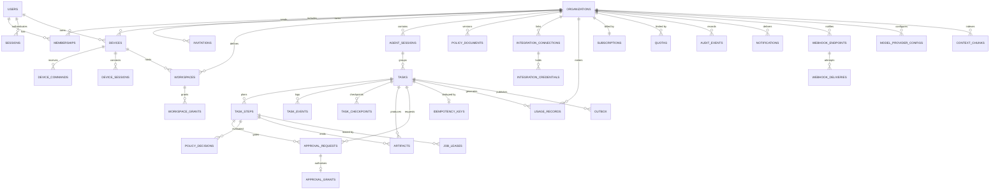

# 06 — Database Design

| | |
|---|---|
| Status | Planning only. **No schema, migration or seed file is created in this phase.** |
| Owner | Data architecture |
| Engine | PostgreSQL 18.x (`ADR-019`), accessed via Prisma 7.10 (`ADR-020`) through `TenantScopedDb` |
| Rule | Every tenant-owned table has a **non-nullable** `organization_id`. There are no exceptions and no nullable tenant columns. |
| Related | `03` §5.9 (ownership), `08` (task/event semantics), `11` (data protection), `13` (growth) |

## 1. Conventions

| Convention | Rule |
|---|---|
| Primary keys | `uuid` (UUIDv7 preferred — time-sortable, non-enumerable). `[OPEN]` confirm the generation library/DB support; UUIDv4 is the fallback. |
| Foreign keys | Real FK constraints, `ON DELETE RESTRICT` by default; `CASCADE` only for pure children (e.g. `task_steps` → `tasks`) where deletion is already gated by policy. |
| Timestamps | `created_at`, `updated_at` as `timestamptz` (UTC). Server-generated. `deleted_at` where soft-delete is used. |
| Money | Integer minor units (`amount_minor bigint`) + ISO-4217 `currency`. Never floats. |
| Enum-ish columns | Postgres enums for stable small sets (task state, risk class); a lookup table for anything the product may extend (tool names, providers). |
| JSON columns | `jsonb` only for genuinely schemaless payloads (tool arguments, provider settings, event data) **and always validated by a contract before write**. |
| Naming | `snake_case` tables/columns; plural table names; FK `<singular>_id`. |
| Sensitive columns | Named with a suffix (`*_enc`, `*_digest`) and listed in §6; encrypted with envelope encryption (per-row DEK wrapped by a KMS CMK). |
| No business logic in the DB | No triggers that mutate business state; the only planned DB-side logic is RLS policies (Phase 10) and generated columns if justified. |
| Tenant predicate | A query without `organization_id` in the `where` clause must be impossible to write — enforced by `TenantScopedDb` and a lint rule against raw `prisma.<model>` access. |

## 2. Entity catalogue

`[PROPOSED]` ~34 tables in eight groups. "Tenant" column: `Y` = has
`organization_id`; `N` = global/system; `via-parent` = reachable only through a
tenant-owned parent and still carries the scope for defence in depth.

### 2.1 Identity and tenancy

| Table | Purpose | PK | Key fields | Tenant | Retention |
|---|---|---|---|---|---|
| `users` | A person | `id` | `email` (citext, unique), `email_verified_at`, `password_hash` (Argon2id), `password_changed_at`, `display_name`, `locale`, `timezone`, `mfa_enabled`, `totp_secret_enc`, `status` (`active`/`suspended`/`deleted`), `last_login_at` | N | Account life + 30 d `[ASSUMPTION]` |
| `user_identities` | Federated identities (OIDC) | `id` | `user_id`, `provider`, `subject`, `email_at_link`, `linked_at` | N | Account life |
| `organizations` | Tenancy root | `id` | `name`, `slug` (unique), `kind` (`personal`/`team`), `plan_id`, `default_execution_location`, `data_retention_days`, `settings jsonb`, `status` | Y (self) | Life + 30 d grace `[ASSUMPTION]` |
| `memberships` | User ↔ Org with role | `id` | `user_id`, `organization_id`, `role` (`owner`/`admin`/`member`/`viewer`), `joined_at`, `invited_by` | Y | Life of membership + audit |
| `invitations` | Pending invite | `id` | `organization_id`, `email`, `role`, `token_hash`, `expires_at`, `accepted_at`, `invited_by` | Y | 30 d after expiry |
| `sessions` | Web/API session | `id` | `user_id`, `organization_id` (active), `token_hash`, `user_agent`, `ip_hash`, `created_at`, `last_seen_at`, `expires_at`, `revoked_at`, `mfa_satisfied_at` | via-parent | 90 d `[ASSUMPTION]` |
| `refresh_tokens` | Rotating refresh chain | `id` | `session_id`, `token_hash`, `family_id`, `replaced_by`, `used_at`, `expires_at` | via-parent | 30 d after expiry |
| `service_accounts` | Non-human principals (CI, webhooks) | `id` | `organization_id`, `name`, `scopes[]`, `status` | Y | Until deleted |

### 2.2 Devices and workspaces

| Table | Purpose | PK | Key fields | Tenant | Retention |
|---|---|---|---|---|---|
| `devices` | A registered local runner | `id` | `organization_id`, `user_id` (owner), `name`, `os`, `os_version`, `runner_version`, `public_key` (Ed25519), `key_algorithm`, `fingerprint` (unique), `status` (`pending`/`active`/`revoked`), `capabilities jsonb` (`{gpu:{name,vram_mb}, models:[], commands:[], playwright:true}`), `last_seen_at`, `revoked_at`, `revoked_by`, `revoke_reason` | Y | Life + 90 d audit `[ASSUMPTION]` |
| `device_pairing_codes` | Short-lived device-authorisation codes | `id` | `organization_id`, `code_hash`, `created_by`, `expires_at` (≤ 10 min `[ASSUMPTION]`), `redeemed_at`, `redeemed_device_id` | Y | 24 h |
| `device_sessions` | Live connection records | `id` | `device_id`, `connection_id`, `connected_at`, `disconnected_at`, `client_version`, `remote_ip_hash` | via-parent | 30 d |
| `device_commands` | Durable commands queued for a device (delivery, not state) | `id` | `organization_id`, `device_id`, `task_id`, `step_id`, `kind`, `payload jsonb`, `command_digest`, `seq`, `state` (`pending`/`sent`/`acked`/`expired`), `created_at`, `sent_at`, `acked_at`, `expires_at` | Y | 7 d after terminal `[ASSUMPTION]` |
| `workspaces` | A directory a device may operate on | `id` | `organization_id`, `device_id`, `path` (canonical), `label`, `mode` (`read_only`/`read_write`), `created_by`, `last_used_at`, `status` | Y | Life + 30 d |
| `workspace_grants` | Persistent `external_directory` grants | `id` | `organization_id`, `workspace_id`, `path_pattern`, `effect`, `expires_at`, `granted_by`, `policy_version` | Y | Until expiry |

### 2.3 Agent sessions, tasks, steps

| Table | Purpose | PK | Key fields | Tenant | Retention |
|---|---|---|---|---|---|
| `agent_sessions` | Conversation/context container | `id` | `organization_id`, `user_id`, `title`, `execution_location`, `model_config jsonb`, `token_usage` (let `-1` mean none), `created_at`, `archived_at` | Y | Configurable (default 90 d) |
| `tasks` | A durable unit of work | `id` | `organization_id`, `agent_session_id`, `created_by`, `device_id` (nullable if cloud), `goal`, `constraints jsonb` (`max_steps`, `max_wall_clock_s`, `max_tokens`, `max_cost_minor`, `deadline`), `execution_location` (`device`/`cloud`), `state` (enum), `state_changed_at`, `risk_class` (highest seen), `plan jsonb` (current plan snapshot), `policy_version`, `budget_used jsonb`, `result_summary`, `error` (code + safe message), `idempotency_key_id`, `started_at`, `finished_at`, `lease_owner`, `lease_expires_at`, `attempts` | Y | Configurable (default 90 d content, 400 d metadata) |
| `task_steps` | One planned unit (tool call or model turn) | `id` | `organization_id`, `task_id`, `seq` (per task), `kind` (`model`/`tool`/`approval`/`verify`), `title`, `tool_name`, `tool_version`, `arguments jsonb`, `arguments_digest`, `risk_class` (`R0`–`R4`), `state` (enum), `depends_on[]`, `attempts`, `max_attempts`, `lease_id`, `lease_owner`, `heartbeat_at`, `started_at`, `finished_at`, `result jsonb` (capped), `result_digest`, `error_code`, `idempotency_key` (unique per task+step intent), `cost_minor`, `tokens` | Y | Same as task |
| `task_checkpoints` | Resumable progress | `id` | `organization_id`, `task_id`, `step_seq`, `state_blob_enc` (bounded, encrypted), `workspace_ref` (git commit/ref or snapshot id), `created_at` | Y | Same as task |
| `task_events` | Append-only event log | `id` (bigserial) + unique `(task_id, seq)` | `organization_id`, `task_id`, `seq` (monotonic per task), `type`, `data jsonb` (redacted, capped), `actor` (`user`/`device`/`worker`/`system`), `actor_id`, `trace_id`, `created_at` | Y | Shorter than task (default 30 d `[ASSUMPTION]`), partitionable |

### 2.4 Approvals and policy

| Table | Purpose | PK | Key fields | Tenant | Retention |
|---|---|---|---|---|---|
| `approval_requests` | A pending decision for one concrete action | `id` | `organization_id`, `task_id`, `step_id`, `requested_by_device_id`, `action` (canonical), `target`, `arguments_preview jsonb` (redacted), `effect_preview` (diff/summary), `risk_class`, `reason`, `policy_version`, `matched_rule_id`, `digest` (covers all bound fields), `state` (`pending`/`granted`/`denied`/`expired`/`cancelled`), `expires_at`, `decided_by`, `decided_at`, `decision_reason` | Y | Same as task |
| `approval_grants` | The authorisation token record | `id` | `organization_id`, `request_id`, `grant_token_hash`, `action_digest`, `arguments_digest`, `target_digest`, `user_id`, `device_id`, `task_id`, `step_id`, `policy_version`, `nonce`, `issued_at`, `expires_at`, `use_count`, `max_uses`, `revoked_at` | Y | Same as task |
| `policy_documents` | Versioned policy | `id` | `organization_id` (null = built-in floor), `version` (monotonic per org), `scope` (`platform_floor`/`organization`/`device`/`workspace`), `document jsonb`, `created_by`, `created_at`, `active` | Y (null for floor) | All versions retained |
| `policy_decisions` | Why an action was allowed/asked/denied | `id` | `organization_id`, `task_id`, `step_id`, `action`, `resource`, `decision`, `matched_rule_id`, `policy_version`, `evaluated_at`, `context_digest` | Y | 400 d `[ASSUMPTION]` (audit-critical) |
| `risk_overrides` | Per-org risk-class adjustment (tightening only) | `id` | `organization_id`, `action_pattern`, `set_class`, `created_by`, `expires_at` | Y | Until removed + audit |

### 2.5 Artifacts, context, integrations

| Table | Purpose | PK | Key fields | Tenant | Retention |
|---|---|---|---|---|---|
| `artifacts` | Metadata for a produced/captured file | `id` | `organization_id`, `task_id`, `step_id`, `kind` (`diff`/`report`/`screenshot`/`dataset`/`log`/`archive`/`snapshot`), `filename`, `mime_type`, `size_bytes`, `storage_key`, `sha256`, `encryption_key_id`, `visibility` (`task`/`org`), `created_by`, `expires_at` | Y | Task policy; blobs lifecycle-managed |
| `context_chunks` | Retrieval index for project/knowledge context | `id` | `organization_id`, `workspace_id` or `document_id`, `source_path`, `content` (or pointer), `embedding vector(N)`, `token_count`, `content_hash`, `taint` (`trusted`/`untrusted`) | Y | Rebuildable; 30 d of inactivity `[ASSUMPTION]` |
| `integration_connections` | A user/org link to an external service | `id` | `organization_id`, `provider`, `name`, `scopes[]`, `status`, `created_by`, `last_used_at`, `last_error`, `data_sharing_declaration jsonb` | Y | Until disconnected + 30 d |
| `integration_credentials` | Encrypted secrets (or references to a secret manager) | `id` | `organization_id`, `connection_id`, `kind` (`oauth_token`/`api_key`/`basic`), `secret_enc` (envelope), `secret_digest`, `expires_at`, `rotated_at` | Y | Deleted with connection |
| `webhook_endpoints` | Customer-facing webhooks | `id` | `organization_id`, `url`, `event_types[]`, `secret_enc`, `status`, `created_by` | Y | Until deleted |
| `webhook_deliveries` | Delivery attempts | `id` | `organization_id`, `endpoint_id`, `event_id`, `attempt`, `state`, `response_status`, `response_digest`, `next_attempt_at` | Y | 7 d `[ASSUMPTION]` |

### 2.6 Usage, plans, quotas

| Table | Purpose | PK | Key fields | Tenant | Retention |
|---|---|---|---|---|---|
| `plans` | Product plans | `id` | `code`, `name`, `limits jsonb`, `price_minor`, `currency`, `active` | N | Permanent |
| `subscriptions` | Org's commercial state | `id` | `organization_id`, `plan_id`, `status`, `current_period_start/end`, `external_customer_id`, `external_subscription_id`, `cancel_at_period_end` | Y | Life + 7 y `[ASSUMPTION]` (accounting) |
| `quotas` | Effective limits per org/period | `id` | `organization_id`, `metric`, `period_start`, `period_end`, `limit_value`, `overridden_by` | Y | 25 months `[ASSUMPTION]` |
| `usage_records` | Immutable metered measurements | `id` | `organization_id`, `metric` (`task`, `task_seconds`, `tokens_in`, `tokens_out`, `cloud_exec_seconds`, `browser_seconds`, `artifact_bytes`, `model_calls`), `quantity`, `unit`, `task_id`, `device_id`, `provider`, `model`, `recorded_at`, `idempotency_key` (unique) | Y | 25 months |
| `usage_rollups` | Pre-aggregated per day/org/metric | `id` | `organization_id`, `metric`, `period_date`, `quantity` | Y | 25 months |

### 2.7 Notifications and audit

| Table | Purpose | PK | Key fields | Tenant | Retention |
|---|---|---|---|---|---|
| `notifications` | In-app notification | `id` | `organization_id`, `user_id`, `kind`, `title`, `body_preview`, `ref` (task/approval/device), `read_at`, `created_at` | Y | 90 d |
| `notification_preferences` | Per-user channel settings | `id` | `user_id`, `organization_id`, `channel`, `kind`, `enabled` | Y | Life |
| `audit_events` | Immutable security-relevant record | `id` (bigserial) | `organization_id` (nullable for platform events), `actor_type`, `actor_id`, `device_id`, `action`, `resource_type`, `resource_id`, `result`, `reason`, `ip_hash`, `user_agent_digest`, `trace_id`, `metadata jsonb` (redacted), `created_at` | Y | 400 d default `[ASSUMPTION]`; up to 7 y by contract |
| `login_attempts` | Abuse/rate tracking | `id` | `email_digest`, `ip_hash`, `success`, `method`, `created_at` | N | 30 d |

### 2.8 Platform mechanics

| Table | Purpose | PK | Key fields | Tenant | Retention |
|---|---|---|---|---|---|
| `idempotency_keys` | HTTP mutation replay protection | `id` | `organization_id`, `scope` (route), `key`, `request_digest`, `response_status`, `response_body jsonb`, `state` (`in_progress`/`completed`), `expires_at` | Y | 24 h `[ASSUMPTION]` |
| `outbox` | Durable publication of domain events | `id` (bigserial) | `aggregate_type`, `aggregate_id`, `organization_id`, `event_type`, `payload jsonb`, `available_at`, `attempts`, `last_error`, `processed_at` | Y | 7 d after processed |
| `job_leases` | Cross-process ownership for workers/reaper visibility | `id` | `resource_type`, `resource_id`, `lease_id`, `owner`, `acquired_at`, `heartbeat_at`, `expires_at` | via-parent | 7 d |
| `feature_flags` | Tenant/user targeting | `id` | `key`, `enabled`, `targets jsonb`, `updated_by` | N | Permanent |
| `schema_migrations` | `[FACT]` Backend-convention placeholder | — | Prisma's own migration table (`_prisma_migrations`) is authoritative | N | Permanent |
| `model_provider_configs` | Per-org model providers and limits | `id` | `organization_id`, `provider`, `base_url`, `credential_ref`, `allowed_models[]`, `max_tokens_per_task`, `enabled`, `data_sharing_ack_at` | Y | Until removed |

## 3. ER diagram (core relationships)

## 4. Indexing strategy

`[PROPOSED]` Indexes exist for access patterns that are actually in the API or
the engine. No speculative indexes.

| Table | Index | Access pattern it serves |
|---|---|---|
| `users` | unique `email`; `status`, `created_at` | sign-in, admin listing |
| `memberships` | unique `(organization_id, user_id)`; `(user_id)`; `(organization_id, role)` | tenant guard, "my orgs", admin |
| `sessions` | unique `token_hash`; `(user_id, revoked_at)`; `expires_at` | auth on every request, revocation, cleanup |
| `devices` | unique `fingerprint`; `(organization_id, status)`; `(organization_id, last_seen_at desc)` | device list, offline detection, reaper |
| `device_commands` | `(device_id, state, seq)`; `(expires_at)` where state='pending' (partial) | device drain by cursor, TTL sweep |
| `workspaces` | unique `(device_id, path)` | duplicate registration prevention |
| `tasks` | `(organization_id, state, created_at desc)`; `(organization_id, created_by, created_at desc)`; `(device_id, state)`; unique `idempotency_key_id` where not null | dashboards, history, device work routing, dedupe |
| `tasks` | partial `(lease_expires_at)` where `state in (PLANNING,RUNNING)` | lease reaper |
| `task_steps` | unique `(task_id, seq)`; `(task_id, state)`; unique `idempotency_key`; partial `(heartbeat_at)` where `state='RUNNING'` | step ordering, progress, reaper |
| `task_events` | unique `(task_id, seq)`; `(task_id, created_at)`; `(organization_id, created_at)` (partition local) | SSE replay by `Last-Event-ID`, timeline, audit |
| `approval_requests` | `(organization_id, state, expires_at)`; `(task_id)`; unique `(step_id)` where state='pending' | approval inbox, TTL sweeper, per-step lookup |
| `approval_grants` | unique `grant_token_hash`; `(request_id)`; `(expires_at)` | grant verification on execution |
| `policy_documents` | unique `(organization_id, scope, version)` | effective-policy resolution |
| `policy_decisions` | `(task_id, step_id)`; `(organization_id, decision, evaluated_at)` | explainability, admin filtering |
| `artifacts` | `(task_id, kind)`; `(organization_id, created_at desc)`; `(expires_at)` | workspace UI, retention sweep |
| `context_chunks` | `(organization_id, workspace_id)`; HNSW/IVFFlat on `embedding` (`[OPEN]` pgvector index choice) | retrieval |
| `usage_records` | unique `idempotency_key`; `(organization_id, metric, recorded_at)` | metering, roll-ups, idempotent increment |
| `audit_events` | `(organization_id, created_at desc)`; `(actor_type, actor_id, created_at)`; `(action, created_at)` | audit search |
| `idempotency_keys` | unique `(organization_id, scope, key)`; `(expires_at)` | replay protection, cleanup |
| `outbox` | partial `(available_at)` where `processed_at is null`; `(aggregate_type, aggregate_id)` | publisher polling |
| `job_leases` | unique `(resource_type, resource_id)`; `(expires_at)` | single-owner claim |

Notes: `organization_id` is the leading column of nearly every composite index —
tenant-scoped queries stay index-only on the tenant prefix. All list endpoints
use keyset pagination (`created_at, id`) rather than `OFFSET`.

## 5. Tenant ownership and access restrictions

| Data class | Who may read | Who may write | Notes |
|---|---|---|---|
| Tenant business data (tasks, steps, events, artifacts metadata, approvals, workspaces) | Members of the owning org, per role (`viewer` read-only) | `member`+ via API; workers through the tenant-scoped layer | `viewer` cannot see approval contents marked sensitive |
| Secrets (`*_enc`: provider credentials, integration credentials, TOTP secrets, webhook secrets) | **No client, ever.** Only the server process that must use them | Rotation endpoints only | Never returned by any API, never logged, never in an event payload |
| Audit events | `admin`/`owner`, plus platform operators for support with an audit record | Append-only (no updates) | Impersonation writes a `actor_type=operator` audit event |
| Usage records | `member`+ for their org (aggregated), platform admin for all | Ingestion only; no updates after terminal | Immutable by policy |
| Platform tables (`feature_flags`, `plans`) | Platform admin | Platform admin | Not tenant-scoped; access gated by an operator role that tenant users cannot hold |
| Model provider configs | `admin`+ | `admin`+ | Credential values are references, not values |

Hard rules:
1. Tenanted reads always require an authenticated principal **and** a membership
   row in the org being read. Cross-org access returns 404 (not 403) to avoid
   existence disclosure.
2. Soft-deleted or suspended orgs resolve to no access.
3. Operator (support) access is a distinct principal type, always audited, and
   cannot read `*_enc` values.

## 6. Sensitive fields (enumerated, for the security review)

| Table | Field | Protection |
|---|---|---|
| `users` | `password_hash` | Argon2id, tuned parameters, never logged, never returned |
| `users` | `totp_secret_enc` | Envelope-encrypted; decrypted only during MFA verification |
| `sessions`, `refresh_tokens`, `invitations`, `device_pairing_codes` | `*_token_hash`, `code_hash` | SHA-256 of a high-entropy token; raw value only in the response that mints it |
| `devices` | `public_key` (**not** sensitive), `fingerprint` | Public only. Private key never leaves the device |
| `integration_credentials`, `webhook_endpoints`, `model_provider_configs` | `secret_enc`, `credential_ref` | Envelope encryption via KMS; decrypted only in the consuming process |
| `task_steps`, `task_events`, `artifacts`, `approval_requests` | `arguments`, `result`, `data`, previews | Redaction pass on write; size caps; secret-pattern scrubber; taint labels preserved |
| `task_checkpoints` | `state_blob_enc` | Encrypted (may contain workspace/prompt fragments) |
| `audit_events`, `policy_decisions`, `login_attempts` | `ip_hash`, `user_agent_digest`, `email_digest` | Hashed with a server-side pepper for correlation without raw PII |
| any table | `metadata jsonb` | Allow-listed keys only; the contract rejects unknown keys |

## 7. Transactions and consistency

| Operation | Transaction boundary | Why |
|---|---|---|
| Create task | `tasks` insert + first `task_events` insert + `outbox` insert + `idempotency_keys` upsert | The task must exist iff the work is queued (NFR-REL-02) |
| Allocate step | `task_steps` state transition + `job_leases` claim (compare-and-set on `lease_id`) + `task_events` append | Single-owner execution; prevents two workers running the same step |
| Complete step | `task_steps` update + `usage_records` inserts (idempotent) + `task_events` append + `artifacts` metadata insert + `outbox` insert | Effect, evidence and metering must be atomic |
| Grant approval | `approval_requests` state + `approval_grants` insert + `task_events` + notification outbox | The step may only proceed with a durable, checked grant |
| Revoke device | `devices` state + `approval_grants` revocation (all pending for that device) + `device_commands` expire + `audit_events` | Revocation must not be partially applied |
| Usage increment | Insert with unique `idempotency_key`; conflict = already counted | Exactly-once metering |
| Retention sweep | Batched deletes in bounded chunks per org, each batch a transaction | Avoid long locks |

Isolation: `READ COMMITTED` is sufficient for all of the above **because every
state transition is a compare-and-set on a version/lease column**, not a
read-modify-write. `SERIALIZABLE` is reserved for any future multi-row invariant
where two rows must agree (none planned).

## 8. Idempotency records

| Layer | Key | TTL | Behaviour |
|---|---|---|---|
| HTTP mutation | `(organization_id, route-scope, Idempotency-Key header)` → `request_digest` | 24 h `[ASSUMPTION]` | Same key + same digest → cached response replayed. Same key + different digest → `409 idempotency_conflict` |
| Task creation | `tasks.idempotency_key_id` | Task lifetime | Duplicate submission of the same logical task returns the original task |
| Step effect | `task_steps.idempotency_key` (e.g. `task:step:tool:argsDigest`) | Task lifetime | Prevents a retried step from applying a side effect twice |
| Tool-level external effect | Tool-specific effect key recorded in `task_steps.result` / an effect ledger inside the tool adapter | Provider-dependent | Prevents double-posted PR comments, double-sent emails |
| Usage | `usage_records.idempotency_key` | 25 months | Exactly-once metering |
| Webhook delivery | `(endpoint_id, event_id, attempt)` | 7 d | At-least-once delivery, exactly-once recording |

## 9. Migration strategy

`[PROPOSED]`

1. **Forward-only.** Prisma migrations; no down migrations in production
   (rollback is a new forward migration). Every migration is reviewable SQL
   committed to the repo.
2. **Expand/contract** for anything touching a live table: add nullable column →
   backfill in batches → dual-write if needed → switch reads → make NOT NULL →
   drop the old column in a later release. Never a dropping/renaming migration
   in the same release as the code that stops using it.
3. **Gated execution.** Migrations run as a separate job **before** the new
   application version is rolled out, with an advisory lock (`pg_advisory_lock`)
   so only one runner proceeds. Failure aborts the deploy.
4. **Backfill discipline.** Batched (≤ 5,000 rows `[ASSUMPTION]`), throttled,
   resumable, with progress in metrics; never in a request path.
5. **Destructive-change control.** `DROP TABLE`/`DROP COLUMN`/type narrowing
   requires an explicit approval, a backup taken within 24 h, and a two-release
   delay after the code stops using it.
6. **Local/dev:** `prisma migrate dev` for authoring; seeds are idempotent and
   dev-only. **Staging:** full migration rehearsal against a restored copy of
   production-shape data monthly `[ASSUMPTION]`.
7. **Verification:** after each deploy, a smoke query asserts the expected
   schema version and row-count sanity.

## 10. Data deletion, export and retention

| Concern | Design |
|---|---|
| Org deletion | Soft-delete → 30-day grace (recoverable) → hard-delete job: artifacts blobs first, then rows in FK order, then credential material, then the org row. A tombstone audit record (org id + timestamps, no content) is retained. |
| User deletion | Remove membership; content created by the user stays with the org (org-owned), personal data (profile, sessions, tokens, TOTP) deleted; a "user deleted" audit event is retained. |
| Per-task deletion | Deletes steps/events/checkpoints/artifacts metadata + blobs; the `audit_events` entry that a task was deleted remains (no content). |
| Retention enforcement | A maintenance worker runs daily, per org, honouring `data_retention_days`; each sweep is bounded and logged. Because migrations and sweeps both touch large tables, both are throttled. |
| Export | Async export job producing a JSON (and CSV for events) bundle in object storage, listed in `artifacts` with a short expiry; trigger recorded in `audit_events`. |
| Legal hold | `[OPEN]` whether customers need per-org or per-matter hold; if yes, retention sweeps skip flagged orgs. |
| Residency | One region at launch `[ASSUMPTION]`; a region field on `organizations` prepares for multi-region later without a schema rewrite. |

## 11. Backup, restore and continuity

| Item | Plan (Phase 10; simpler before that) |
|---|---|
| Automated backups | Managed Postgres: continuous WAL archiving + daily snapshots, encrypted, cross-AZ; retention 30 d `[ASSUMPTION]` |
| PITR | Enabled; target RPO ≤ 15 min (`NFR-REL-04`) |
| Restore rehearsal | **Monthly** automated restore into an isolated environment + a smoke test; failure is an incident. A backup never restored is not a backup. |
| Object storage | Versioning + lifecycle rules; artifacts are re-generable except user-uploaded inputs (those are immutable and versioned) |
| Redis | Explicitly *not* backed up: it holds no system-of-record data (ADR-021). Recovery = let the outbox republish and let the reaper requeue. |
| Runbook | Restore procedure with exact commands, owner and expected duration, stored in `infrastructure/disaster-recovery/` (Phase 10) |
| Secrets | KMS keys with rotation; a restore that needs a lost key is a reportable incident — keys are backed by the KMS service's own durability |

## 12. Connection pooling and growth

| Topic | Plan |
|---|---|
| Pool per process | `api` pool = `min(10, floor(db_max_connections_budget / api_replicas))` `[ASSUMPTION]`; workers get smaller pools (2–4) because they are mostly queue-bound |
| Total budget | Reserve ~20% of `max_connections` for migrations, operators and the reaper. Exceeding it is an alert, not a surprise |
| PgBouncer | Introduce in **transaction** mode once `api` replicas × pool > ~120 connections `[ASSUMPTION]`; note Prisma+pgbouncer requires disabling prepared statements |
| Long-lived work | Never hold a transaction across a model call or a tool execution. Lease rows, commit, work, commit again |
| Read replicas | Add when read p95 latency or replica CPU justifies it; only for read-only endpoints that tolerate replication lag (dashboards, history, audit search). Never for a read that precedes a write |
| Partitioning | `task_events`, `audit_events`, `usage_records`, `webhook_deliveries`: monthly range partitions when a table exceeds ~50 GB or when retention deletes become lock-heavy `[ASSUMPTION]` |
| Sharding | Not planned. If simply-needed growth arrives, prefer vertical scaling → read replicas → partitioning → then consider functional splits (ADR-008) |
| Vacuum/bloat | Autovacuum tuned for append-heavy tables (`task_events`, `audit_events`); monitor bloat |
| Statement timeouts | Every connection sets a statement timeout; no unbounded queries in production |
| Hot rows | Avoid counter rows (e.g. a single usage counter per org); use append-only usage records + rollups to prevent row contention |

## 13. Anti-patterns banned by this design

1. No tenant table without `organization_id` (a "global" table must be justified in review).
2. No cross-module direct table access (use the owning module's interface).
3. No JSON blob as a substitute for a relational relationship the system queries.
4. No soft-delete column that retention sweeps ignore.
5. No `SELECT *` into application code that then forwards the row to a client (redaction by field allow-list instead).
6. No secret, token or key stored unencrypted, ever, including in `jsonb` columns.
7. No mutation without an audit record when it affects security or billing.
8. No unbounded list endpoint; every list is keyset-paginated and capped.

Labels: `[FACT]` `[ASSUMPTION]` `[PROPOSED]` `[OPEN]`
